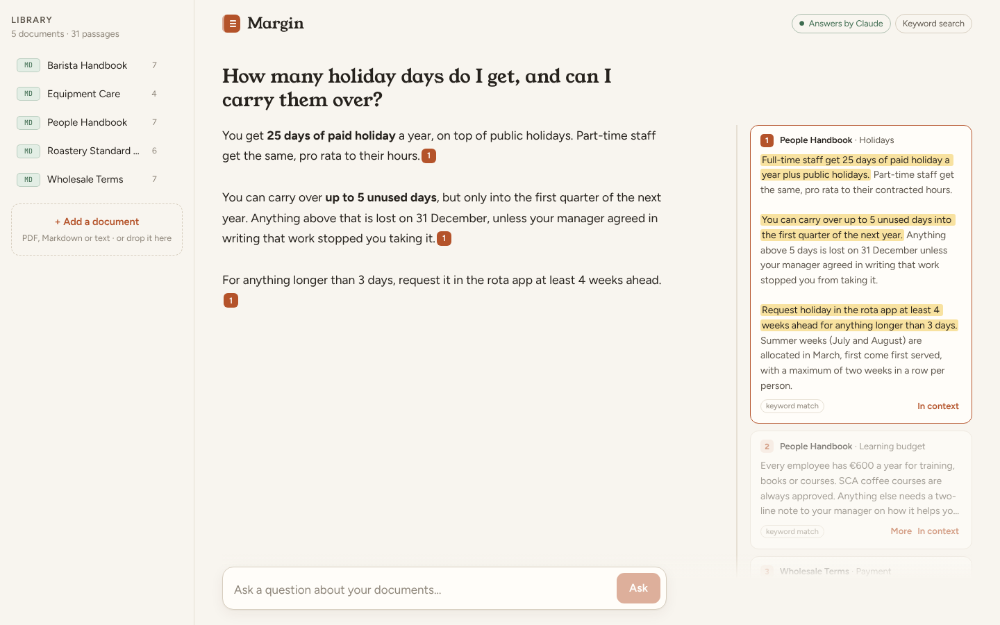

# Margin

Ask questions about your company's documents and get short answers where every sentence points to the passage it
came from. Hover a marker and the exact quote lights up in the margin; click through to read it in context.



It ships with a sample library, the internal handbook of a fictional coffee roaster (holidays, espresso recipes,
wholesale terms, equipment care), so it is useful from the first run. Upload your own PDFs, Markdown or text files
to replace it.

## How it works

```
upload ─► parse (PDF pages / Markdown) ─► chunk by heading, ~900 chars ─► embed (Voyage) ─► Postgres + pgvector
                                                                         └► BM25 keyword index (in memory)

question ─► keyword search ─┐
          └► vector search ─┴► reciprocal rank fusion ─► top 6 passages ─► Claude (search_result blocks,
                                                                           citations on) ─► streamed to the UI
```

- **Hybrid retrieval.** BM25 catches exact terms (product names, "€180", "82 points"); embeddings catch paraphrases
  ("paid vacation" finds the *Holidays* section). The two rankings are merged with reciprocal rank fusion, so neither
  needs its scores tuned against the other. Vectors live in pgvector with an HNSW cosine index.
- **Citations from the API, not from the prompt.** Passages go to Claude as `search_result` content blocks with
  citations enabled. The model returns each claim with the exact `cited_text` and the index of the passage it came
  from, so the UI can highlight the quote without asking the model to format references, and nothing can be cited
  that wasn't retrieved.
- **Streaming.** `POST /api/ask` streams server-sent events: the retrieved sources first, then text and citation
  events as the answer is written. The front end reads the stream with `fetch`.
- **Works without keys.** No `ANTHROPIC_API_KEY`: Margin quotes the best-matching sentences instead of writing an
  answer. No `VOYAGE_API_KEY`: search is keyword-only. Both modes show in the header.

## Stack

Python 3.13, FastAPI, SQLAlchemy, Postgres + pgvector (SQLite for local runs), rank-bm25, the Anthropic Python SDK,
Voyage AI embeddings. React 19 + TypeScript + Vite. Docker, GitHub Actions.

## Run it

Locally, with SQLite and no keys needed:

```bash
cp .env.example .env              # set MARGIN_PASSWORD, and ANTHROPIC_API_KEY for written answers
uv sync
(cd web && npm ci && npm run build)
uv run uvicorn margin.main:app --reload
```

Open http://localhost:8000 and sign in as `reader` with your `MARGIN_PASSWORD`. For front-end work, run
`npm run dev` in `web/` as well; Vite proxies `/api` to port 8000.

With Postgres and pgvector:

```bash
cp .env.example .env              # set MARGIN_PASSWORD and DB_PASSWORD
docker compose up --build
```

## Tests and evals

```bash
uv run pytest                     # parsing, chunking, auth, uploads, streaming, citation mapping, hybrid search
uv run python -m evals.retrieval  # does the right passage reach the top 3?
```

The retrieval eval asks 20 questions against the sample library and checks that the section holding the answer is
in the top 3 results. With keyword search alone it scores 90% recall@3; the misses are the paraphrased questions
("Who do I phone if the grinder dies on a Saturday?"), which is the gap embeddings close. Set `VOYAGE_API_KEY` to
run it with hybrid search. CI fails if recall drops below 80%.

## Security notes

- **Login.** Every route except `/api/health` needs HTTP Basic auth, compared in constant time. If
  `MARGIN_PASSWORD` is unset in local runs, a random password is generated and logged once; Docker Compose refuses
  to start without one. Serve it behind HTTPS in any shared deployment, since Basic auth sends the password with each
  request, and add rate limiting at the proxy.
- **CSRF.** Browsers resend Basic credentials automatically, so every write (`POST`, `DELETE`) must carry
  `X-Requested-With: margin`. Another site can't add that header without a CORS preflight, and Margin allows none.
- **Uploads.** Only `.pdf`, `.md`, `.markdown` and `.txt`, at most 10 MB and 500 PDF pages. PDFs must start with the
  PDF signature; encrypted PDFs are refused; text must be UTF-8. Only the extracted text is kept; the
  original file is never stored or served back.
- **Prompt injection.** Document text only ever reaches the model as search results, never in the system prompt,
  and the system prompt tells Claude to treat instructions inside documents as text. The model has no tools, so a
  poisoned document can at worst skew an answer, and the citations show where it came from.
- **Headers.** A strict Content Security Policy (`default-src 'self'`, `frame-ancestors 'none'`), `nosniff` and
  `no-referrer` on every response. API docs are disabled.
- **Secrets.** Keys come from the environment or `.env`, which is git-ignored. The Docker image runs as an
  unprivileged user, and Compose binds the app to `127.0.0.1` only.
